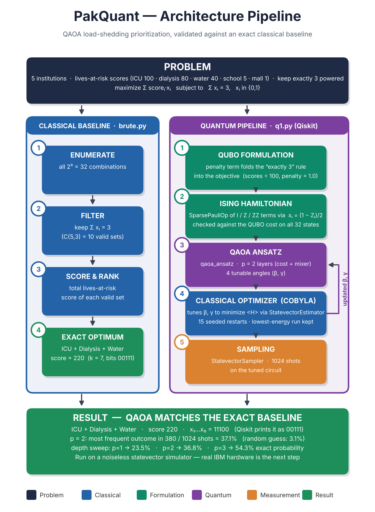

# PakQuant — Qiskit Fall Fest 2026 Hackathon

**Team:** Muhammad Abdul Rehman (26i-0526) · Muhammad Shehryar Malik · Muhammad Taha Ikram
**Institution:** FAST-NUCES Islamabad

## Problem
During a power shortage a grid operator can keep only **3 of 5** critical institutions powered this hour.
Each is scored by lives at risk if left without power: ICU 100, dialysis 80, water pumping 40, school 5, mall 1.
Goal: choose the 3 that minimize harm (maximize total score kept powered).



## Files
| File | What it does |
|---|---|
| `brute.py` | Exact classical baseline: enumerates all 32 combinations, ranks the 10 valid ones |
| `q1.py` | Quantum solver: QUBO → Ising Hamiltonian → QAOA (Qiskit), COBYLA, 1024 shots |
| `verify_numpy.py` | Optional Qiskit-free cross-check: re-implements the same QAOA in plain NumPy |
| `PakQuant_Report_FINAL.docx` / `.pdf` | Full project report |
| `requirements.txt` | `qiskit`, `numpy`, `scipy` |

## Run
```bash
git clone https://github.com/Abdul-Rehman-9127/Pakquant.git
cd Pakquant
python3 -m venv .venv && source .venv/bin/activate
pip install -r requirements.txt
python brute.py
python q1.py        # a minute or two on a laptop
python verify_numpy.py   # optional independent cross-check (NumPy only)
```

**Bit convention:** qubit *i* ↔ institution *i* (0 = ICU … 4 = mall). Qiskit prints bitstrings as `q4…q0`, so the
optimal answer ICU + dialysis + water prints as **`00111`** in both `brute.py` and `q1.py`
(in institution order x₁…x₅ it is `11100`). `q1.py` prints both forms and decodes every outcome to names.

## Expected results
`brute.py` ends with:
```
best k = 7  score = 220  bits = 00111
powered: ICU + dialysis + water
```
`q1.py` (seeded; tested with Qiskit 2.6.2) prints the Hamiltonian, a sanity check that the Hamiltonian equals the QUBO cost on all
32 bitstrings, a depth sweep, then the top-10 shots:

| p | Energy | P(optimal) | P(valid) |
|---|---|---|---|
| 1 | −1.054 | 23.5% | 53.1% |
| 2 | −1.413 | 36.8% | 60.3% |
| 3 | −1.717 | 54.3% | 69.1% |

The p = 3 row can differ in the last digit across Qiskit/SciPy versions (COBYLA is sensitive to tiny floating-point differences).

Headline run (p = 2, 1024 shots): most frequent outcome **ICU + dialysis + water, score 220, 380/1024 = 37.1%**
(random guess over 32 states = 3.1%). 60.1% of shots are valid (exactly 3 powered).

## Method notes
* QUBO: `−Σ wᵢxᵢ + A(Σxᵢ − 3)²`, with `wᵢ = scoreᵢ/100` and `A = 1.0` (= 100 lives, the largest single score). `A ≥ max(wᵢ)` is a safe bound
  that stops any rule-breaking state from beating the best valid one (for this instance the true minimum is only `A > 0.05`, so 1.0 is conservative).
* Scores are normalized so the Hamiltonian has O(1) coefficients — with raw coefficients (e.g. penalty 500) the QAOA angle
  landscape oscillates and COBYLA fails to find the optimum.
* COBYLA is local, so 15 seeded restarts are used and the **lowest-energy** run is kept (selection never uses the known answer).

## A bug we caught
Our first version (raw scores, penalty 500) printed `11100` as its most frequent Qiskit outcome, which *looks* like the answer if read in
reverse. Decoded properly it is water + school + mall (score 46); the true optimum had only ~0.2% probability. The fixes: normalised scores,
a principled penalty, restarts, and decoding every shot to institution names. `verify_numpy.py` independently reproduces the corrected results.

## Honest limitations
* Runs on a **noiseless statevector simulator**, not real IBM hardware; real-device success rates would be lower.
* No quantum advantage is claimed: with 5 additive scores this is solvable classically (even by sorting). The contribution is a
  verified end-to-end QUBO → Ising → QAOA pipeline checked against ground truth.
* About 40% of shots violate the "exactly 3" rule; in practice one filters invalid shots and picks the best valid one.

## Credits
Built with Qiskit (IBM) and SciPy (COBYLA). AI assistance (Claude) was used for explanation, debugging and review;
all conclusions and results are the team's own.
